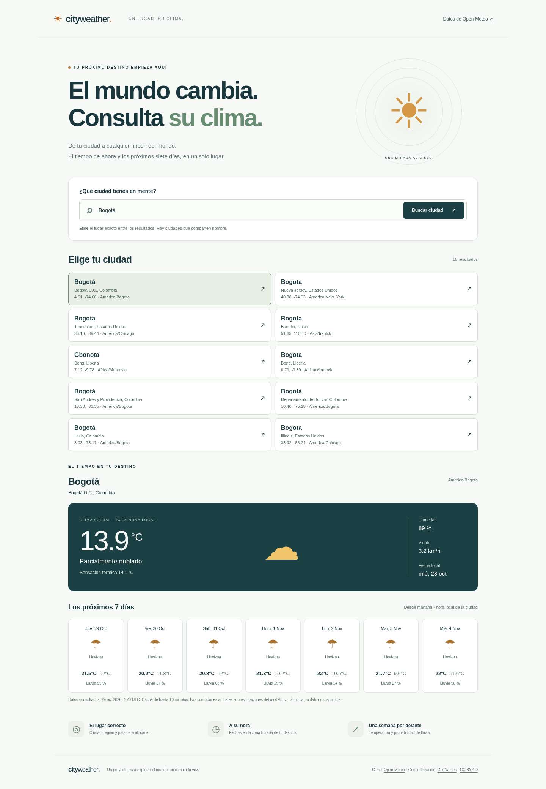

# City Weather

Aplicación de portafolio full stack: busca una ciudad, distingue lugares homónimos y consulta las condiciones actuales y los **siete días desde mañana**, respetando el calendario local del destino.

**Estado: entrega 1 implementada.** Angular + Java/Spring Boot, con Open-Meteo detrás del backend. Registro, inicio de sesión, PostgreSQL, favoritos e historial **todavía no están implementados**. Consulta [las entregas y sus criterios de aceptación](docs/ROADMAP.md).

## Vista previa



Captura de una consulta real del 28 de octubre de 2026; no representa el clima actual al leer este documento. [Vista móvil](docs/screenshots/weather-mobile.png).

## Ejecutar en local

Requisitos: Node.js 24.15 o posterior de la rama 24, npm, Java 21 y Maven 3.9. Python 3 solo para las pruebas E2E.

Terminal 1:

```sh
cd backend
mvn spring-boot:run
```

Terminal 2:

```sh
cd frontend
npm ci
npm start
```

Abre http://localhost:4200. El proxy de desarrollo envía `/api` a `localhost:8080`. Angular nunca llama directamente a Open-Meteo. No requiere credenciales ni base de datos para esta entrega.

Alternativa con Docker:

```sh
docker compose up --build
```

Abre http://localhost:8080. El contenedor construye Angular y lo sirve desde Spring Boot, con el mismo origen. El build ejecuta las pruebas Java y usa un usuario sin privilegios. La imagen no incluye datos de ejemplo.

## Qué permite

- Búsquedas de 2–80 caracteres; nombres con acentos y puntuación habitual. Hasta 10 coincidencias con región, país, coordenadas y zona horaria.
- Temperatura, sensación térmica, humedad, viento y estado del cielo. Unidades explícitas: °C, km/h y %.
- Siete días desde mañana: máximas, mínimas y probabilidad de precipitación. Se solicitan ocho días al proveedor y se excluye hoy.
- Errores claros, reintento manual y estados de búsqueda, espera y lista vacía. No hay clima inventado ni fallback silencioso.
- Caché en memoria por 10 minutos, hasta 500 entradas por tipo de consulta. Se conserva la hora original de obtención. Nunca se almacenan errores.
- Timeout de conexión y lectura de 5 segundos; límite de espera en Angular de 20 segundos. Presupuesto saliente por instancia de 500/minuto, 4.500/hora y 9.000/día.
- Diseño adaptable, controles HTML nativos, foco visible, enlace para saltar al contenido, anuncios de estado y movimiento reducido.

Las condiciones actuales de Open-Meteo son estimaciones meteorológicas de modelos. Los datos nulos se representan como `—`, nunca como cero. Los fixtures solo se usan en pruebas.

## Pruebas

```sh
cd backend
mvn verify
cd ../frontend
npm ci
npm test
npm run build
npx playwright install chromium
npm run test:e2e
```

Las pruebas de integración Java arrancan un proveedor HTTP local y recorren controlador → servicio → HTTP. Verifican homónimos, validación, caché, fechas, unidades, campos nulos, errores externos, JSON inválido y timeout. Las pruebas E2E recorren Angular → Spring Boot → proveedor local simulado. No consumen la API externa. `npm run test:e2e` requiere el JAR generado por `mvn verify`, Java y Python en PATH.

Para una comprobación real (requiere Internet), ejecuta la app con configuración predeterminada y busca Bogotá. Compara la fecha local, la zona y los datos con Open-Meteo. Las respuestas externas varían y no forman parte de las pruebas deterministas.

Resultados y límites de lo comprobado: [verificación de esta entrega](docs/VERIFICATION.md).

## API y arquitectura

```text
Navegador / Angular → /api → Spring Boot → Open-Meteo
                               ├─ validación y errores
                               ├─ caché temporal limitada
                               └─ presupuesto de solicitudes externas
PostgreSQL → previsto en entrega 2 (no conectado)
```

| Ruta | Resultado |
| --- | --- |
| `GET /api/cities?q=Bogotá` | Lista de ciudades; `[]` si no hay coincidencias |
| `GET /api/weather?latitude=4.71&longitude=-74.07` | Clima, siete días, unidades, zona y `fetchedAt` UTC |
| `GET /api/health` | Salud del proceso, sin llamar al proveedor |

Errores JSON `{code,message}`: 400 entrada inválida, 429 presupuesto agotado, 502 proveedor no disponible o respuesta inválida, 504 timeout externo. Los textos originales del proveedor y las trazas no se exponen.

El backend resuelve la zona mediante `timezone=auto`. Las fechas locales sin offset se muestran como calendario del destino, sin convertirlas a la zona del navegador. `fetchedAt` es un instante UTC. Los identificadores GeoNames distinguen los resultados; el clima se consulta por coordenadas validadas.

No se habilita CORS global: desarrollo usa proxy y despliegue sirve ambos componentes en un origen. URLs del proveedor solo configurables en el servidor. En esta entrega no existen rutas privadas ni datos por usuario.

## Despliegue gratuito

Incluye `render.yaml` para un servicio Docker gratuito de Render. Crea un repositorio **independiente** en GitHub, sube este contenido y conecta el repositorio como Blueprint en Render. No se ha publicado ningún repositorio ni despliegue desde este entorno.

Un único servicio sirve frontend y backend, sin configurar CORS ni una URL pública de API en Angular. Salud: `/api/health`. Consulta [configuración y limitaciones](docs/DEPLOYMENT.md).

## Proveedor y atribución

Condiciones revisadas el **28 de octubre de 2026**, en las [condiciones oficiales de Open-Meteo](https://open-meteo.com/en/terms): la API gratuita permite uso **no comercial**; menos de 10.000 llamadas/día, 5.000/hora y 600/minuto, con 300.000/mes en su tabla de límites. Se requiere atribución [CC BY 4.0](https://creativecommons.org/licenses/by/4.0/). La app muestra créditos de [Open-Meteo](https://open-meteo.com/) y [GeoNames](https://www.geonames.org/).

Una demo educativa sin publicidad ni suscripción encaja en sus ejemplos no comerciales; usarla como promoción comercial puede requerir otro acuerdo. Revisa las condiciones antes de monetizar o promocionar servicios. El presupuesto local no garantiza la cuota en IPs compartidas, múltiples instancias o reinicios. No hay reintentos automáticos que multipliquen llamadas.

Referencias: [Forecast API](https://open-meteo.com/en/docs), [Geocoding API](https://open-meteo.com/en/docs/geocoding-api), [versiones Angular](https://angular.dev/reference/versions), [requisitos Spring Boot](https://docs.spring.io/spring-boot/3.5/system-requirements.html).
# city-weather
